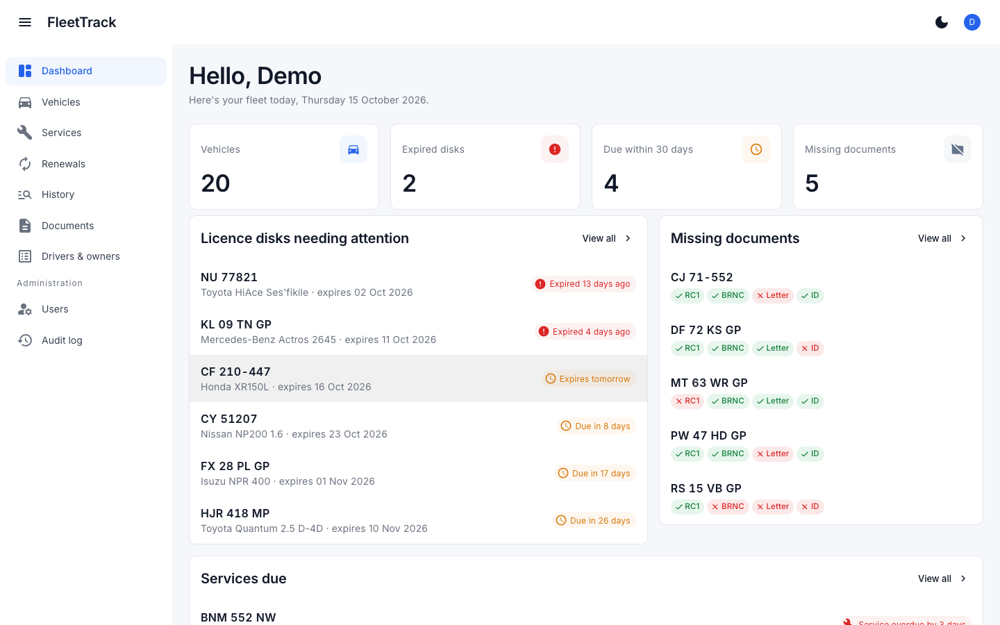
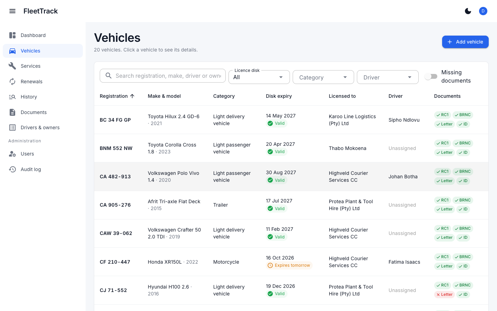
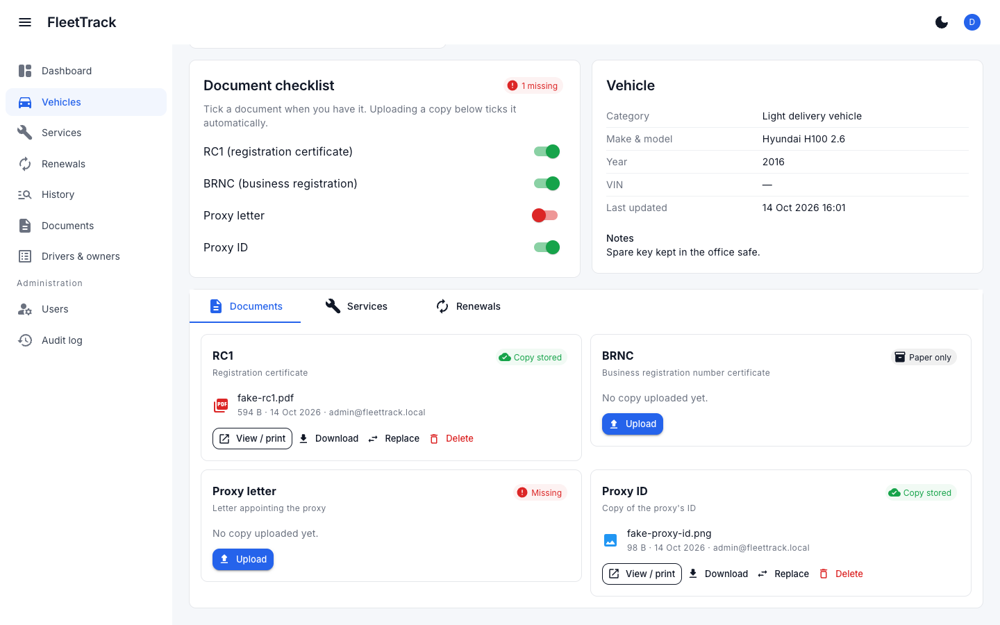
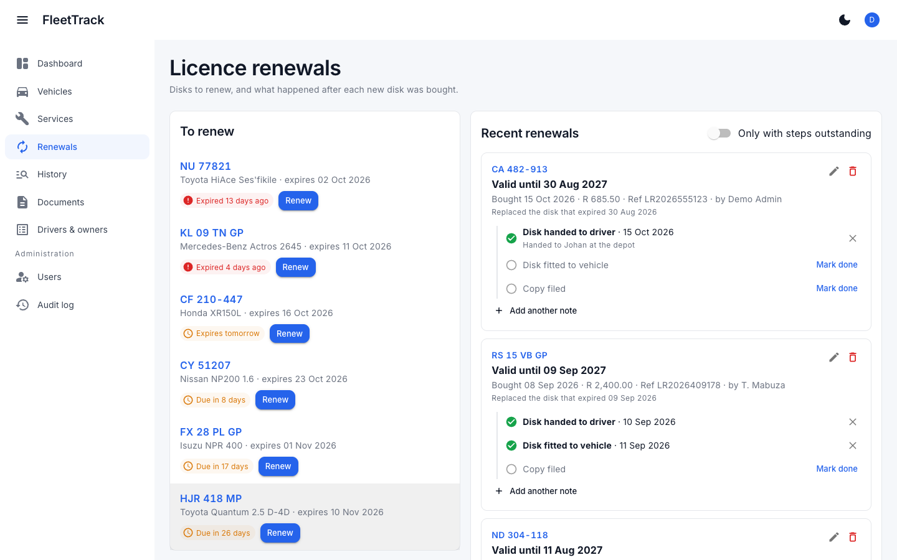
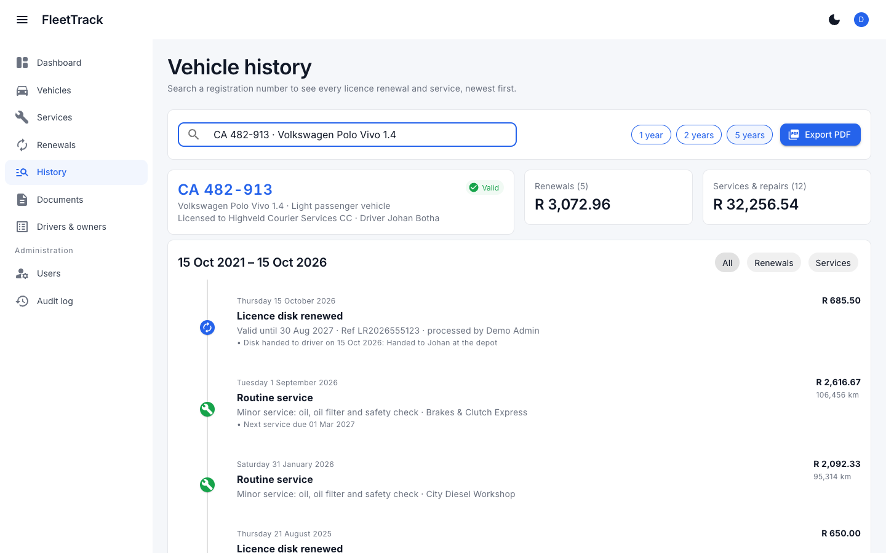
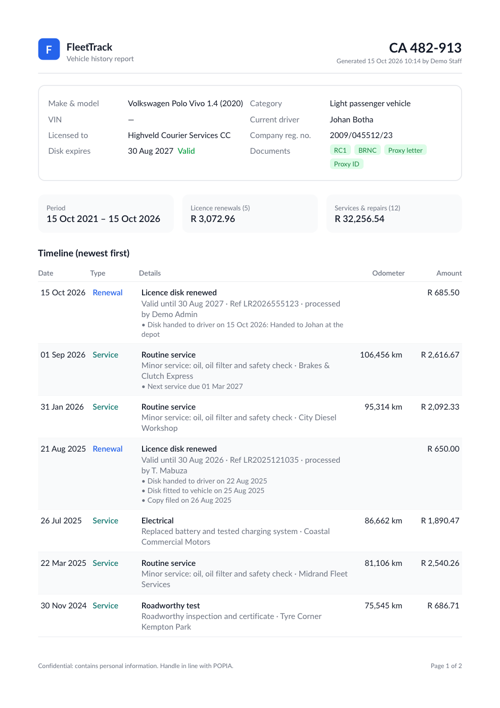
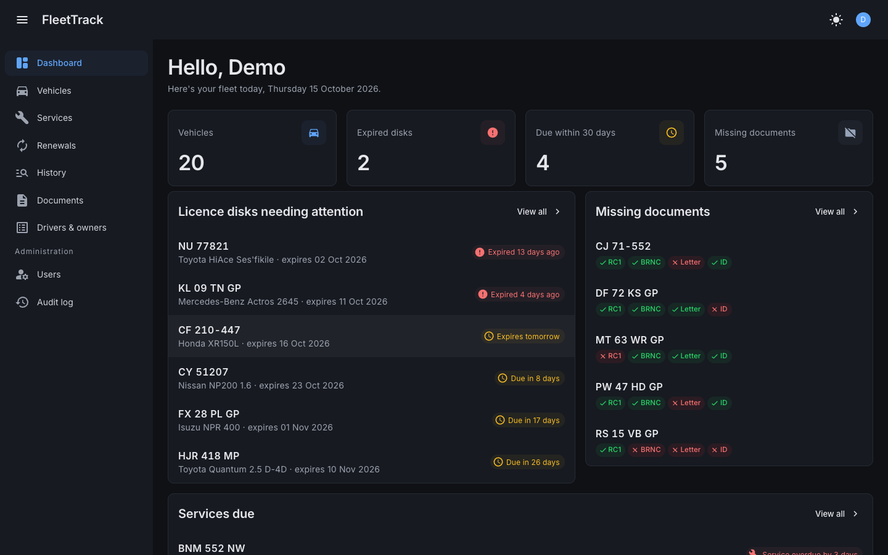
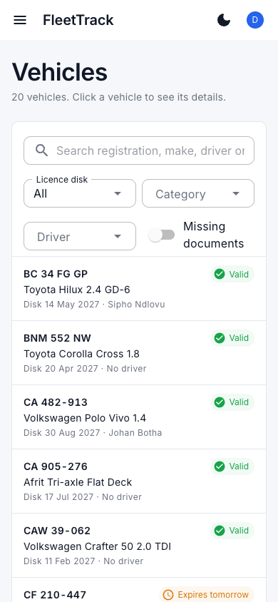
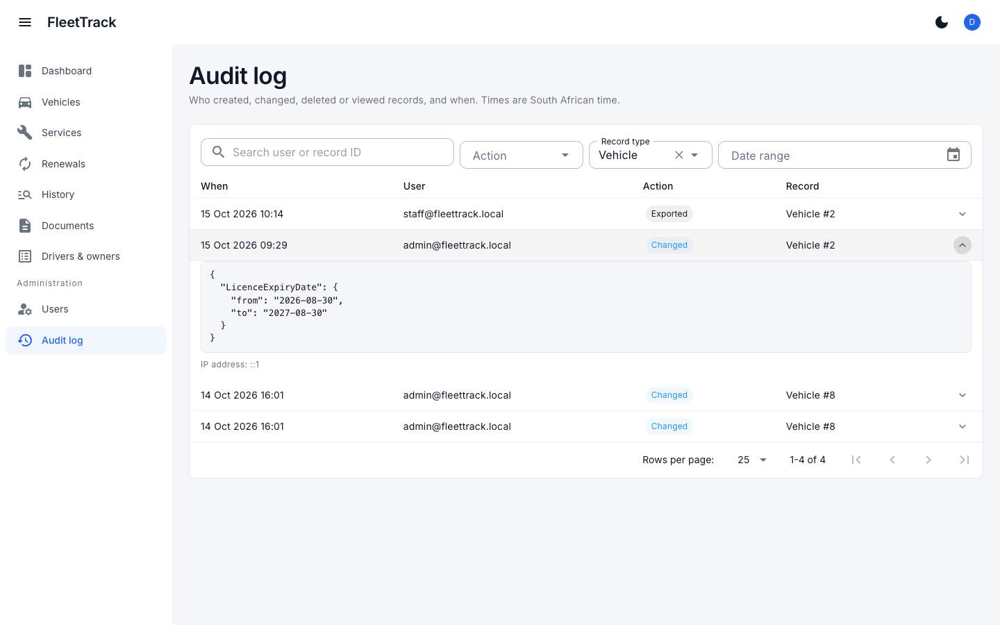
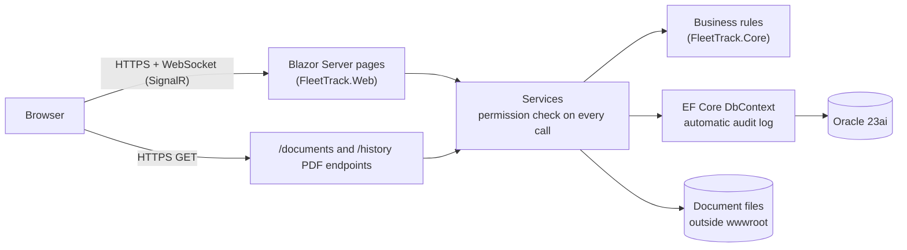

# FleetTrack

**A secure vehicle management system for a South African roadworthy centre:** licence disks, vehicle documents, drivers, services and renewals in one place, with role-based access and an audit trail designed around POPIA.

[](https://github.com/Moses2906/fleettrack/actions/workflows/ci.yml)




> **All data in this repository is fictional.** Companies, people, ID numbers, registration numbers and documents are made up for demonstration. No real company data is ever committed.

---

## Contents

- [Features](#features)
- [Security and POPIA](#security-and-popia)
- [Tech stack](#tech-stack)
- [Getting started](#getting-started)
- [Demo logins](#demo-logins)
- [Running the tests](#running-the-tests)
- [Configuration](#configuration)
- [Project structure](#project-structure)
- [Design decisions](#design-decisions)
- [Licences](#licences)

## Features

### Dashboard
Counts of expired licence disks, disks due within 30 days, vehicles with missing documents and services due, each linking straight to the matching filtered list.

### Vehicles
- Table sorted by registration number with instant search. Searching `ca123456` finds `CA 123-456`.
- Filters for disk status, category, driver and missing documents.
- Colour-coded disk status badges: **valid**, **due within 30 days**, **expired**. Each badge also has an icon and text, so colour is never the only signal.
- South African registration validation (provincial, Western Cape and personalised formats) and duplicate detection that ignores spacing.
- Licence holders can be companies (CIPC registration number) or individuals (SA ID number, checked with the Luhn check digit and masked on screen).
- Compact card layout on phones.

| Vehicles | Vehicle documents |
|---|---|
|  |  |

### Documents
- Upload RC1, BRNC, proxy letter and proxy ID copies (PDF, JPG or PNG, up to 10 MB).
- Uploading a copy ticks it off on the vehicle's checklist; admins can also tick a document as held on paper.
- View, print and download through a permission-checked endpoint. Every view and download is audit-logged.
- An overview page showing which copies are stored, paper-only or missing for every vehicle.

### Service and maintenance
- Log services and repairs: date, odometer, type of work, workshop, cost and notes. Odometer readings that go backwards are caught as likely typos.
- Optional next-service date with in-app reminders for services that are overdue or due within 30 days.

### Licence renewals
- Record a renewal: purchase date, new expiry, amount, reference and who processed it. **Saving a renewal updates the vehicle's expiry date in the same transaction.**
- Track what happened afterwards (disk handed to driver, fitted to vehicle, copy filed) with dates and notes.
- Entering an old renewal for the history never moves the current expiry date backwards, and deleting a mistaken renewal restores the previous date.

| Renewals | Vehicle history |
|---|---|
|  |  |

### Vehicle history and PDF export
Search any registration to see a five-year timeline of renewals and services, newest first, then export it as a PDF report.



### Design
Clean, minimal interface (MudBlazor with the Inter typeface), sidebar navigation, card-based dashboard, a remembered dark/light mode, and layouts that work on phones and tablets.

| Dark mode | Phone |
|---|---|
|  |  |

## Security and POPIA

Security was designed in from the first phase, not added at the end.

**Access control**
- Every page requires sign-in. A fallback authorization policy protects anything not explicitly marked public, and a test fails if any page other than sign-in or error is reachable anonymously.
- Two roles. **Admin** has full access, including deleting records, uploading documents and managing users. **Staff** can view vehicles, history, the dashboard and documents, and log services, but cannot edit or delete anything.
- Permissions are defined once ([`RolePermissions`](src/FleetTrack.Core/Security/Permissions.cs)) and **enforced on the server in every service method**, not just by hiding buttons. Tests call the services directly as Staff to prove that edits and deletes are refused.

**Accounts**
- Strong password rules (12+ characters, mixed case, digit and symbol).
- Account lockout after 5 failed attempts, plus a per-IP rate limit on sign-in.
- Two-factor authentication (authenticator app) and passkeys are available to every user.
- No public sign-up: admins create accounts and reset passwords. The last active admin can't be removed, disabled or demoted.
- Disabled accounts are signed out of open sessions within 5 minutes.
- Sign-in cookies are `HttpOnly`, `Secure` and `SameSite=Lax`, with an 8-hour sliding expiry and no "remember me" (safer on shared office PCs).

**Web protections**
- HTTPS only, with HSTS in production. HTTP is upgraded before anything else runs.
- A strict Content Security Policy (`script-src 'self'`, no inline scripts) plus `X-Frame-Options`, `nosniff`, `Referrer-Policy` and `Permissions-Policy`.
- Anti-forgery tokens on every form post, including sign-out. Open redirects after sign-in are blocked.
- Data access goes only through EF Core (parameterised queries; no raw SQL in the codebase). Razor encodes all output.
- Every input is validated twice: in the form, and again on the server.

**Documents**
- File type is detected from the file's content ("magic bytes"), never its name. A web page renamed to `.pdf` is rejected.
- Files are stored outside `wwwroot` under random names, and the storage layer refuses any other name, which blocks path traversal.
- A SHA-256 hash is checked on every open to detect tampering. Files are served with `no-store` caching.

**POPIA**
- Staff can view ID documents (a deliberate business decision), so **every view, download and PDF export is audit-logged** with user, time and IP address.
- The audit log records old and new values for vehicle data, but **only field names** for personal information. Deleting someone's data on request therefore doesn't leave a copy in the log, and tests check that ID numbers never appear there.
- Admins can permanently delete a vehicle (with its documents, files, services and renewals) or a licence holder on request. The audit log keeps only the fact of the deletion.
- ID numbers are masked in lists and reports, and the PDF carries a confidentiality footer.
- Secrets are never in source code: user secrets locally, environment variables on a server.



## Tech stack

| Area | Technology |
|---|---|
| Framework | ASP.NET Core 10 (LTS), Blazor Server (interactive server rendering) |
| Language | C# 14 |
| Database | Oracle Database 23ai Free (Docker for local development) |
| Data access | Entity Framework Core 10 with the Oracle provider, upper snake-case naming |
| Authentication | ASP.NET Core Identity (roles, lockout, 2FA, passkeys) |
| UI | MudBlazor 9, Inter typeface |
| PDF | QuestPDF |
| Tests | xUnit with the EF Core in-memory provider |
| CI | GitHub Actions (build and run all tests on every push) |



## Getting started

### Prerequisites
- [.NET 10 SDK](https://dotnet.microsoft.com/download/dotnet/10.0)
- [Docker Desktop](https://www.docker.com/products/docker-desktop/) (or Colima on macOS) to run Oracle Database Free

### 1. Clone and configure the database password

```bash
git clone https://github.com/Moses2906/fleettrack.git
cd fleettrack
cp .env.example .env
```

Edit `.env` and choose two passwords. The file is git-ignored.

### 2. Start Oracle

```bash
docker compose up -d
docker ps          # wait until fleettrack-oracle shows (healthy), about 1–2 minutes the first time
```

This runs Oracle Database 23ai Free and creates an application user called `fleettrack`.

### 3. Give the app its connection string (kept out of source code)

```bash
dotnet user-secrets set "ConnectionStrings:DefaultConnection" \
  "User Id=fleettrack;Password=<ORACLE_APP_PASSWORD from .env>;Data Source=localhost:1521/FREEPDB1" \
  --project src/FleetTrack.Web
```

### 4. Run

```bash
dotnet dev-certs https --trust     # once, so the browser trusts the local HTTPS certificate
dotnet run --project src/FleetTrack.Web --launch-profile https
```

Open **https://localhost:7282**. In Development the app creates the tables and loads 20 fictional vehicles, with five years of renewals and services, on first start.

To query the data directly, connect SQL Developer (or the SQL Developer extension for VS Code) to `localhost:1521`, service `FREEPDB1`, user `fleettrack`. Table and column names are plain Oracle style:

```sql
SELECT registration_number, licence_expiry_date
FROM vehicles
WHERE licence_expiry_date < TRUNC(SYSDATE);
```

## Demo logins

Created **only in the Development environment** (never on a production server):

| Role | Email | Password |
|---|---|---|
| Admin | `admin@fleettrack.local` | `Admin#Demo2026` |
| Staff | `staff@fleettrack.local` | `Staff#Demo2026` |

On a real installation, the first admin is created from the `BootstrapAdmin__*` environment variables (see below), and admins create everyone else.

## Running the tests

```bash
dotnet test
```

The 148 tests need no database: they use EF Core's in-memory provider and a temporary folder for files. They cover:

- **Business rules:** disk expiry status and its 30-day boundary; renewals updating the expiry date (and never moving it backwards); reverting a deleted renewal; service reminders; odometer checks; SA registration, ID number and company number validation; file-type detection.
- **Role permissions:** the permission table, plus Staff being refused every create, edit, upload and delete when calling the services directly.
- **Security:** only the sign-in and error pages are public, admin pages need the right permission, and the Content Security Policy allows no inline or external scripts.
- **Audit and POPIA:** values are logged for vehicle data, but ID numbers and free-text notes never are.
- **Documents:** disguised files and files over 10 MB are rejected, replacing a copy deletes the old file, tampered files are refused, and deleting a vehicle deletes its files.
- **PDF:** a report is generated for every seeded vehicle.

## Configuration

Settings come from `appsettings.json`, user secrets (development) or environment variables (servers). In environment variables, `:` becomes `__`.

| Setting | Purpose |
|---|---|
| `ConnectionStrings__DefaultConnection` | Oracle connection string (required) |
| `Storage__DocumentsPath` | Folder for uploaded documents. Default `App_Data/documents`; on a server use a folder outside the app. |
| `DataProtection__KeysPath` | Folder for the keys that encrypt sign-in cookies, so restarts don't sign everyone out |
| `BootstrapAdmin__Email`, `BootstrapAdmin__Password`, `BootstrapAdmin__FullName` | Creates the first admin on a fresh production database; remove afterwards |
| `ASPNETCORE_ENVIRONMENT` | `Development` applies migrations and loads demo data automatically; `Production` does neither |

In production, apply database changes deliberately with a reviewed script:

```bash
dotnet tool restore
dotnet ef migrations script --idempotent --project src/FleetTrack.Web -o migrate.sql
```

## Project structure

```
src/
  FleetTrack.Core/        Entities and business rules. No database or UI code, so it's easy to test.
    Entities/             Vehicle, LicenceHolder, Driver, ServiceRecord, LicenceRenewal, AuditLog, ...
    Rules/                LicenceStatusRules, RenewalRules, ServiceRules, RegistrationNumbers, IdentityNumbers, ...
    Security/             Roles, permissions and the role-to-permission table
  FleetTrack.Web/         Blazor Server app
    Components/           Pages, layouts and dialogs (MudBlazor)
    Data/                 DbContext, EF configurations, migrations, audit logging, demo seeding
    Documents/            File storage, upload rules and the /documents endpoint
    History/              Timeline and PDF report
    Security/             Permission checks, sign-in rules, security headers
    Services/             Application services: every read and write goes through these
tests/
  FleetTrack.Tests/       xUnit tests
docs/screenshots/         Images used in this README (fictional data)
docker-compose.yml        Local Oracle Database Free
```

## Design decisions

- **Status is calculated, not stored.** "Expired" changes at midnight without anyone editing a row, so it's derived from the expiry date by a pure, tested function using South African time.
- **A Core project with no dependencies** keeps the business rules testable without a database, web server or UI.
- **Short-lived database contexts.** Blazor Server keeps one connection per browser tab for hours, so services create a fresh `DbContext` per operation instead of sharing a long-lived one.
- **Auditing in `SaveChangesAsync`.** Changes and their audit rows are written in one transaction, so a page can't forget to log, and a change can't be saved without its audit entry.
- **Optimistic concurrency** on vehicles: if two admins edit the same vehicle, the second save is refused instead of silently overwriting the first person's changes.
- **Oracle-friendly schema:** upper snake-case names (`LICENCE_EXPIRY_DATE`), real `DATE` columns, and enums stored as readable text, so the database can be queried naturally in SQL.

## Licences

- [MudBlazor](https://github.com/MudBlazor/MudBlazor) is MIT-licensed.
- [Inter](https://rsms.me/inter/) is used under the SIL Open Font License; see `src/FleetTrack.Web/wwwroot/fonts/INTER-LICENSE.txt`.
- [QuestPDF](https://www.questpdf.com/license/) is used under its **Community licence**, which is free for organisations with annual gross revenue under USD 1 million. A larger organisation running FleetTrack needs a QuestPDF commercial licence.
- [Oracle Database Free](https://www.oracle.com/database/free/) is free to download and use; check Oracle's licence terms before using it in production.

---

Built by [Moses2906](https://github.com/Moses2906) as a working tool for a vehicle roadworthy centre and as a portfolio project.
